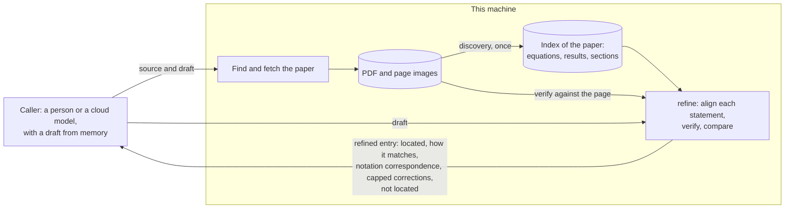
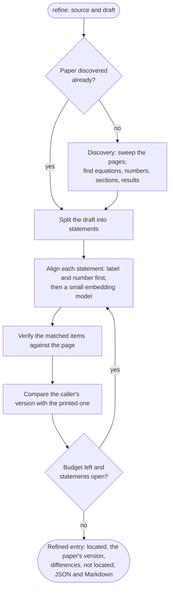

# Design note: what the tool outputs

Status: **draft for discussion**, started 2026-10-18; rewritten the same day
around a single call, `refine`. It comes before the note on layers and
comparison (`planning/comparison.md`, not yet committed): what each layer
must achieve follows from what the outputs promise. Items marked **open**
are to be settled with the user; the answers then go into the plan
(sections 1, 1a, 3 and 8) and the README.

## 1. Purpose

Language models such as Claude remember a great deal of the literature: which
papers are relevant, what they are known for, roughly where an idea appears.
They are unreliable on the details: the exact citation fields, the precise
statement of a result, an equation, its assumptions, its location. People
who know a paper are in the same position: they remember what it contains,
imperfectly, and checking the details means rereading it.

This tool lets the caller, a person or a cloud model, **refine what it
already knows about a paper by checking it against the paper, locally**. The
caller brings the knowledge; the tool brings the paper and exactness. The
paper itself is never sent to a cloud model.

Decided (2026-10-18):

- **The caller already knows what is in the paper.** The tool refines and
  corrects the caller's account; it does not tell the caller what the paper
  contains beyond what the caller pointed at.
- **Retrieval, never verdicts.** The tool reports what the paper says, and
  where; it never says whether a claim is true or supported. The caller
  judges.
- **A tool, not only a skill.** The core is a local, vendor-neutral tool with
  a command line; any cloud model or person can use it. The Claude Code skill
  becomes one adapter (when to use the tool, and the rules of behaviour that
  the obedience tests check). The plan and README follow in their own
  changes.

## 2. The call: `refine`

```
masd refine <source> <draft>
```

- **`source`:** a DOI, arXiv ID, ISBN, title, Zotero item or PDF path. The
  tool finds and fetches the paper if needed (the existing resolver and
  download policy).
- **`draft`:** the caller's account of the paper, written from memory. It may
  be a whole-paper annotation ("introduces the conjugate gradient method;
  proves termination in at most n steps for symmetric positive definite A,
  Theorem 4.1; gives an error bound ..."), a focused draft of what the caller
  wants to cite, or a single line ("CG terminates in n steps").

**Output:** the same entry, refined, as JSON with a rendered Markdown file.
For each statement of the draft:

- **located:** where the paper says it (section, result label, equation
  number, page), with labels corrected where memory had them wrong;
- **how it matches:** the caller's version against the printed one (the
  comparison of stage 5): *matches* (up to notation), *differs*, or *differs
  substantially*;
- **corrections, not the printed form** (decided 2026-10-18): where the
  caller's version differs, the minimal corrections that turn it into the
  paper's, written in the caller's notation ("your `x_i` is `x_1` in the
  paper; the paper's version has an extra factor in the denominator").
  Above a cap, the corrections are withheld and the entry says *differs
  substantially* with the location, so that an empty or vague draft cannot
  draw out a whole equation. Missing stated assumptions are corrections too;
- **not located:** where nothing in the paper matches, reported as a result
  of the search, not as a verdict on the statement.

**Equations in the caller's own notation** (decided 2026-10-18). A statement
of the draft can be an equation written in the caller's notation, with the
request to find the paper's matching equations ("I have an equation of this
form; where is it in this paper, perhaps in other notation?"). For each
match, the entry gives:

- its location;
- how it matches: the same up to a consistent renaming of symbols; the same
  structure with differences; or not found;
- the **notation correspondence** ("your `A` is the paper's `K`; your `x` is
  `u`");
- differences beyond the renaming, as capped corrections in the caller's
  notation.

The caller can apply the correspondence to its own equation; the paper's
printed form need not leave the machine. A remembered equation in the paper's
own notation is the same case, with a correspondence that is mostly the
identity.

And for the entry as a whole: the **citation fields** from the records
(Crossref and the others), never from memory, and the **version** described.

**The promise:** every printed item that a statement is compared with is
verified against the page first, or the comparison is marked unverified with
the reason. The tool does not
promise that it located everything the paper says on a subject.

### Audiences

- **People,** on the command line: Markdown and JSON.
- **Cloud models,** through the command line or an MCP server (an open
  protocol several vendors' clients support): the same JSON and Markdown.

Both get the same output; nothing else is shown (no page images, no links
into the PDF).

**Figure 1. `refine`, and what leaves the machine.**



## 3. What leaves the machine

- **Bounded by the caller's own knowledge.** The output follows the draft:
  for each statement, only what is attached to it (its location, how it
  matches, a notation correspondence, capped corrections). Parts of the paper
  the draft does not point at are not returned; reading the whole paper
  through the tool would need knowing it already.
- **No printed equations by default.** The caller gets corrections to its
  own version, never the paper's printed form, so the amount returned grows
  with the caller's error, not with the number of equations asked about,
  and the cap bounds it.
- **Small units.** A location, a correspondence of symbols, a correction.
  Never a proof, a page or a passage of prose.
- **A local log** of what was returned for each paper, reported on request.

**Open:**

- **a. Omissions.** May the refined entry say what the draft did not cover,
  as counts and labels only ("the paper has 9 numbered results; the draft
  mentions 3")? It helps a caller notice a gap without returning content.
- **b. Statements of results:** corrections to the caller's paraphrase (a
  missing assumption, a wrong constant, a wrong label), as for equations, or
  also a short quotation of the key part?
- **d. The cap:** how large a correction may be before it is withheld (for
  example a share of the equation's symbols), and whether the user can raise
  it for a paper (for example one under CC BY).
- **c. Unsure alignment:** several candidate locations, or "not located"?

## 4. What the tool does locally

Four tasks; nothing else:

1. **Discovery,** once per paper and cached: every display equation, number,
   section, numbered result and definition, with its location (layers 2–3 of
   the comparison note). This is what gate 1's judges produced.
2. **Alignment:** matching each statement of the draft to items of the
   index, first by label and number, then by a small embedding model.
3. **Verification** of the matched items against the page (layer 2).
4. **Comparison** of the caller's version with the printed one (stage 5,
   step 3; gate 1b), including **matching up to a consistent renaming of
   symbols**, with the paper's definition links as context (the paper's `K`
   is a matrix, its `u` a vector); the minimal corrections and the cap.

No longer needed locally: summaries, choosing key results, deciding what is
salient, judging claims, meaning trees for whole papers, suspected errata as
a separate product. The caller does those, from the refined entry.

**Figure 2. One `refine`, within a budget.**



## 5. Running on this laptop

The target machine is an M1 Max with 64 GB of unified memory. Measured on it
(plan, section 2): Qwen3-VL 32B writes about 7.6 tokens a second and reads one
equation crop in about 17 s; Marker converts a paper in 5–8 minutes. Memory
holds one 32B model (about 20 GB at 4 bits) at a time, with small models
beside it.

| task | what runs | estimate | when |
|---|---|---|---|
| discovery | Marker; a 0.9B OCR model for a second reading of each equation | 6–11 min for 20 pages (the small model unmeasured) | once per paper, cached |
| alignment | labels and numbers; a small embedding model | seconds per statement (unmeasured) | each `refine` |
| verification | a vision model on one crop, small first, 32B on low confidence | 20–60 s per matched item | each `refine`, cached per item |
| comparison | deterministic first; a small text model for what it does not settle | under a second to seconds | each `refine` |

So a `refine` of a five-statement draft on a paper already discovered takes a
few minutes, mostly verification; the first call on a new paper adds
discovery.

Principles (decided 2026-10-18), kept from the earlier draft:

- **Anytime:** work in order until the budget runs out; what is not reached
  is reported as not yet verified, not hidden.
- **Narrow tasks for small models:** bounded input and constrained output;
  choice over generation ("which candidate reading matches the crop");
  deterministic code for bookkeeping; a cascade to a larger model on low
  confidence; the smallest model that passes, per task, measured at the
  gates, with confidence measured on planted errors rather than trusted.

## 6. Out of scope

Judging whether a claim is true, or whether a result applies to a project;
summarizing a paper the caller has not described; writing to the user's
Zotero library.

## 7. What follows for the layers and gates

- Discovery must find every display equation and numbered item: gate 1's
  ground truth measures it.
- Verification must read one item well against the page: gates 2 and 4.
- Comparison of a remembered version with a printed one is gate 1b's
  question, now with a second use beyond merging judges. Matching up to a
  consistent renaming of symbols needs a structural representation (a parsed
  tree, not tokens): a requirement on gate 1b's choice. Formula retrieval
  (Tangent-S, Approach0: matching with renaming and wildcards) is prior work
  to study. Matrix against index notation, or a rearranged formula, is the
  hard case: the model stage, with "unsure" as an answer.
- **Alignment is new** and needs its own measure: statements whose locations
  are known (from the gate 1 ground truth, written as a caller would write
  them, including with wrong labels, dropped assumptions and other notation),
  checked for located, mislocated and missed; and the corrections, checked
  that they are minimal and that the cap holds.
- The interpretation layers (notation and meaning) shrink to what
  verification and comparison need; the layers note is revised to match.
